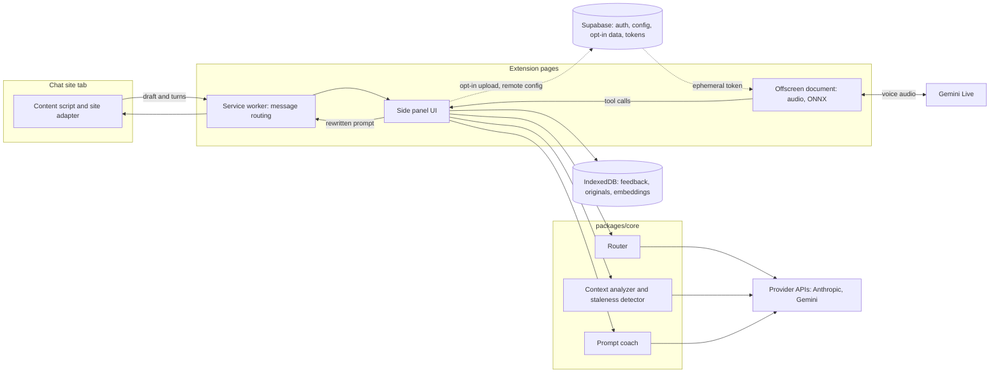

# ADR-001: Product surface and architecture

- **Status:** Accepted
- **Date:** 2026-10-10
- **Deciders:** @nkkrnkl, @mukul54
- **Issue:** #1
- **Source:** [docs/plan.md](../plan.md)

## Context

Shoal helps a person use LLMs well while they work. It does four things:

1. **Routes.** It recommends the model, effort level and strategy that fit the prompt being written.
2. **Analyzes context.** It flags useless, redundant and expired turns in a long conversation, and offers a clean restart.
3. **Coaches.** It critiques and rewrites the draft prompt for the chosen model.
4. **Talks.** It does all of the above by voice through Gemini Live.

The person mostly works in web chat apps: claude.ai, chatgpt.com and gemini.google.com. To help while they type, Shoal has to read the draft prompt and the conversation on those pages, and write a rewritten prompt back into the page.

## Decision

Shoal is a **Manifest V3 Chrome extension** built on a **runtime-agnostic TypeScript core**, with **Supabase** as the only backend.

- **Extension.** The UI is a side panel. Content scripts hold one adapter per chat site. An offscreen document runs audio and WebAssembly. The service worker only routes messages.
- **Core.** `packages/core` holds the router, context analyzer, staleness detector, prompt coach, model catalog and schemas. It uses no Node-only or browser-only APIs, so it runs in extension pages and in Supabase Edge Functions (Deno).
- **Providers.** `packages/providers` implements one LLM client interface for Anthropic and Gemini, with OpenAI optional.
- **Backend.** Supabase provides Auth, Postgres with Row Level Security, Edge Functions, Storage and Cron. It serves sign-in, remote config, opt-in data upload and Gemini Live tokens. It never sees API keys or prompt text unless the user opts in.
- **ML and evals.** `ml/` and `evals/` are Python projects managed with uv. They are offline only and are never shipped in the extension.

## Alternatives considered

| Option | Why not chosen |
|---|---|
| Standalone web app | It cannot see the draft or the conversation on other sites. The user would have to copy and paste everything, which defeats the purpose. |
| Desktop app (Electron or Tauri) | It has the same blindness to page content unless it automates the browser. It is heavier to build, ship and sign. |
| API gateway (RouteLLM or OpenRouter style) | It serves developer traffic, not interactive chat apps. There is no surface for coaching, context health or voice. |
| Extension with no backend | It works for one person with their own keys. It cannot do sign-in, remote config, opt-in training data, or Gemini tokens paid by the project. |
| Cloudflare Workers backend | It would cover functions only. Supabase gives auth, database, storage, cron and functions in one project. |

## Consequences

### Manifest V3 constraints

- **The service worker is ephemeral.** Chrome stops it when idle, so it must not hold WebSockets, audio or long-running state. Gemini Live, microphone capture and ONNX inference run in the side panel or an offscreen document.
- **No remotely hosted code.** Everything executable ships in the package. Model catalog, site selectors, prompt versions and model weights are downloaded as data and validated before use.
- **WebAssembly needs a CSP change.** On-device inference requires `'wasm-unsafe-eval'` in the extension pages content security policy.
- **Stable extension ID.** The manifest `key` is pinned for each environment. OAuth redirect URLs and CORS allow-lists depend on it.

### Provider calls from the browser

- Anthropic calls from extension pages need `dangerouslyAllowBrowser: true` in the SDK. That sends the `anthropic-dangerous-direct-browser-access` header. This is acceptable because the key belongs to the user and stays on their device.
- Current Claude models reject `temperature`, forced `tool_choice` and assistant prefill. JSON output uses structured outputs.

### Security

- **Page text is untrusted data.** Anything read from a chat page goes to Shoal's own LLM calls inside a delimited data block, with an instruction never to follow instructions found inside it.
- **API keys live in `chrome.storage.local` only.** They never go to `chrome.storage.sync`, logs or Supabase.

### Privacy

- **Local-first.** The feedback log, embeddings and original conversation turns stay in IndexedDB.
- **Opt-in upload only.** Metadata upload and raw prompt upload are separate opt-ins. Both are redacted on the client first.
- **Deletion.** Users can delete everything they uploaded.

### Operational

- Two environments, dev and prod, for both the extension build and the Supabase project.
- Releases go through the Chrome Web Store: unlisted for v0.1 to v0.4, public at v1.0.
- Site markup will change without notice. Selectors come from remote config, and a "paste your prompt" fallback always works.

## Data flow



## Repository layout

```
shoal/
  apps/extension/       WXT + React: side panel, content scripts, offscreen document, options, service worker
  packages/core/        router, analyzer, staleness, coach, catalog, schemas (runtime-agnostic)
  packages/providers/   LLM client implementations
  supabase/             migrations, RLS policies, Edge Functions, seed data
  ml/                   Python: datasets, training, ONNX export
  evals/                Python: outcome tables, experiments, reports
  docs/                 plan, ADRs, research notes, privacy policy
```

## Shared interface contracts

These three contracts let the router track (@mukul54) and the context track (@nkkrnkl) build in parallel against stubs. They live in `packages/core/src/contracts/` once the scaffold lands (#3), defined as zod schemas with the TypeScript types inferred from them. The sketches below are the agreed shapes. Changing them needs a pull request reviewed by both owners.

### 1. LLM client

Used by the router, analyzer and coach. Implemented in `packages/providers` (#5).

```ts
export type Provider = "anthropic" | "google" | "openai";
export type Effort = "low" | "medium" | "high" | "xhigh" | "max";

export interface ChatMessage {
  role: "user" | "assistant";
  content: string;
}

export interface CompletionRequest {
  model: string;               // catalog model ID, for example "claude-haiku-5-5"
  system?: string;
  messages: ChatMessage[];
  maxTokens: number;
  effort?: Effort;             // ignored by models without effort control
  jsonSchema?: object;         // request structured output that matches this schema
  signal?: AbortSignal;
}

export interface Usage {
  inputTokens: number;
  outputTokens: number;
  cacheReadTokens?: number;
  costUsd: number;             // computed from the model catalog
}

export interface CompletionResult {
  text: string;
  json?: unknown;              // parsed output when jsonSchema was given
  stopReason: "end" | "max_tokens" | "refusal" | "other";
  usage: Usage;
  latencyMs: number;
  model: string;
}

export interface LLMClient {
  readonly provider: Provider;
  complete(req: CompletionRequest): Promise<CompletionResult>;
  stream(req: CompletionRequest): AsyncIterable<string> & { final(): Promise<CompletionResult> };
}
```

Errors are typed as `RateLimitError`, `AuthError`, `RefusalError` and `ProviderError`. Callers check `stopReason` before using `json`.

### 2. Transcript

Produced by the site adapters (#15) and normalized in #23. Consumed by the analyzer, staleness detector, coach and router.

```ts
export type Site = "claude.ai" | "chatgpt.com" | "gemini.google.com" | "generic";

export interface TurnBlock {
  kind: "text" | "code" | "attachment" | "image";
  text?: string;               // text or code content
  language?: string;           // for code blocks
  name?: string;               // for attachments
}

export interface Turn {
  id: string;                  // stable across re-renders
  index: number;               // 0-based position in the conversation
  role: "user" | "assistant";
  text: string;                // plain text of all blocks, for token counting
  blocks: TurnBlock[];
  tokens: number;              // estimate from the model catalog tokenizer
  ts?: string;                 // ISO 8601, when the site exposes it
}

export interface Transcript {
  site: Site;
  conversationId: string;
  turns: Turn[];
  draft: string;               // the prompt currently being written
  capturedAt: string;          // ISO 8601
}
```

The analyzer's verdict per turn is part of the context track and is defined in #24. Its keys reference `Turn.id`.

### 3. Router output

Defined in detail in #9. The side panel (#16), feedback log (#18), voice tools (#38) and analyzer read it. The analyzer uses `tier` to set how aggressively it prunes.

```ts
export type Tier = "small" | "mid" | "large" | "frontier";
export type Category =
  | "coding" | "math_logic" | "writing" | "factual_qa"
  | "summarization" | "extraction" | "multi_step" | "conversation";
export type Capability = "tools" | "long_context" | "vision" | "current_info";

export interface RouteOption {
  tier: Tier;
  model: string;               // catalog model ID
  effort?: Effort;
  strategy: "single" | "executor_plus_advisor";
  estCostUsd: number;
  estLatencyMs: number;
}

export interface RouterOutput {
  difficulty: 1 | 2 | 3 | 4 | 5;
  category: Category;
  capabilities: Capability[];
  recommendation: RouteOption[]; // best first, at most 3
  confidence: number;            // 0 to 1
  rationale: string;             // one or two sentences shown to the user
  promptVersion: string;         // router prompt version that produced this
}
```

## Follow-ups

- #3 creates `packages/core/src/contracts/` with these schemas, and a test that `deno check` passes on them.
- #9 finalizes the rubric that fills `difficulty` and `category`.
- #24 adds the analyzer verdict schema next to the transcript contract.
